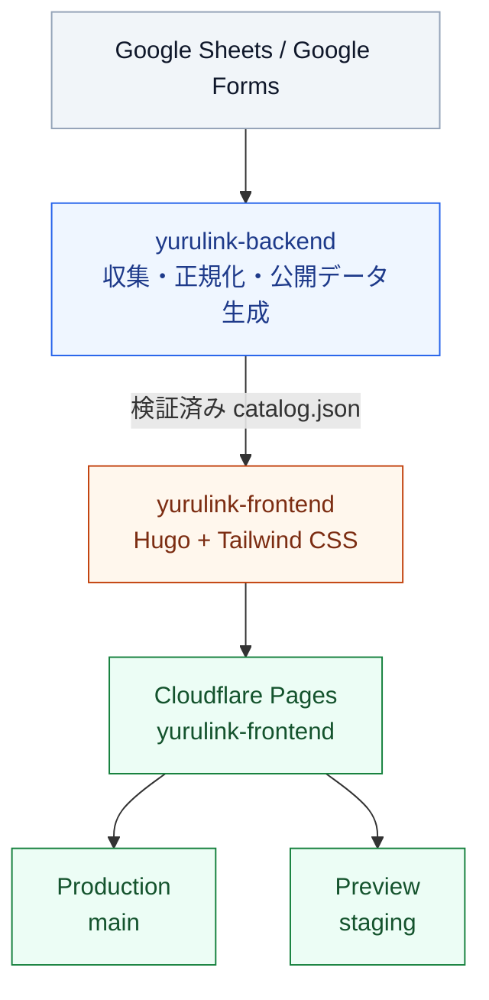

# YuruLink フロントエンド

YuruLinkは、関連番組の動画・プレイリスト・Webリンクなどを横断して探せる静的リンク集です。Backendが生成する統合公開カタログをHugoでビルドし、Cloudflare Pagesで配信します。

## システム構成



`data/public/catalog.json` は `schema_version: 2` の統合形式です。公開リンク実体 `items`、番組 `programs`、コレクション `collections` と、それらの多対多関係 `item_programs`・`memberships` を扱います。2026-11-19現在、`staging`にはGreen Book2由来3,176件とBook4の手動登録9件、計3,185件の統合カタログをBackend Actionsから配信済みです。Hugo・Cloudflare Preview・Playwright Chromium 8件の検証に成功しました。`main`/Productionへの反映および12時間の定期自動公開は未有効化です。

## 技術・機能

| 項目 | 構成 |
| --- | --- |
| サイト生成 | Hugo Extended 0.152.2 |
| ビルド | Node.js 22、npm |
| スタイル | Tailwind CSS v4 |
| 配信 | Cloudflare Pages |
| UI | PCサイドバー、モバイルドロワー、検索、カテゴリー絞り込み、並び替え、ページネーション、カード／リスト表示、テーマ切替 |
| 検証 | GitHub Actions、Smoke Test、Previewデプロイ確認、Playwright Chromium |

番組・プレイリストの表示順はカタログの `order` を参照し、プレイリストには取得できたチャンネル名を表示します。

## デプロイ環境

| ブランチ | Cloudflare Pages | URL |
| --- | --- | --- |
| `main` | Production | https://yurulink-frontend.pages.dev/ |
| `staging` | Preview | https://staging.yurulink-frontend.pages.dev/ |

`staging` の更新時にSmoke Test、コミットSHAに対応するPreviewデプロイの確認、Playwrightによるブラウザ検証を実行します。各テスト結果を確認し、承認後に本番へ反映します。

## ローカル実行

```sh
npm install
npm run build
```

開発サーバーは `npm run css:watch` と `hugo server` を別々のターミナルで起動します。

## 公開データ

YouTubeの収集データは公開品質検査に基づいて掲載します。外部フォーム投稿は審査・承認されたものだけを公開します。回答原本、管理メモ、認証情報は公開JSONに含めません。

## 仕様・運用資料

- [公開カタログ仕様](docs/public-catalog-contract-v2.md)
- [環境・デプロイ](docs/environments.md)
- [デザイン仕様](docs/design-system-phase2.md)
- [Backend](https://github.com/yurulinkdev/yurulink-backend)
