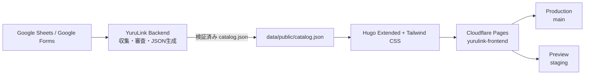

# YuruLink Frontend

YuruLinkは、関連番組の動画・プレイリスト・記事・Webサイト・SNSを横断して探せる**非公式のリンク集**です。公開カタログをHugoで静的サイトへ変換し、Cloudflare Pagesで配信します。

## システム構成



- 公開データは`schema_version: 2`の`catalog.json`です。`items`、`programs`、`collections`、`item_programs`、`memberships`の5つの配列でリンク・番組・コレクションの多対多関係を表します。
- Google Formsの回答原本、SubmissionMasterの審査メモ、未承認投稿、認証情報を公開HTML・JSONへ含めません。
- BackendのBlue／Greenデータ世代とFrontendのProduction／Previewは独立した切替単位です。

## 表示・操作

トップ `/` は軽量な「ようこそ」ページです。検索・全件一覧は `/catalog/` に分離し、トップ訪問だけでは重いカタログHTMLを取得しません。ロゴを押すと `/` に戻ります。ルート `/` はクエリ文字列が付いていても案内だけを表示し、自動的に検索ページへ移動しません。検索条件を共有する場合は `/catalog/?category=...` 等を使用します。

PCでは左サイドバー、スマートフォンでは左上のカテゴリドロワーを用意しています。検索、カテゴリ・種類・番組・日付・出演者による絞り込み、再生数・高評価数・再生時間等の並び替え、ページネーション、カード／リスト表示、テーマ切替を提供します。データが存在しない任意フィールドは未取得として扱い、値を推測して補いません。

ナビゲーションのトップレベルは**YouTube動画**と**その他サイト・SNS**で、「すべてのコンテンツ」を独立して配置します。ナビ分類は表示上の所属先であり、番組の公式性を自動認定するものではありません。YouTube動画のうち300秒未満はサイト内表示上「ショート」として扱いますが、YouTube公式Shorts認定とは異なります。

主なページ：

| URL | 内容 |
| --- | --- |
| `/` | 独立した「ようこそ」ランディング。案内本文の最下部に「すべてのコンテンツ」へのリンクを配置 |
| `/welcome/` | ようこそページの内部管理用パス（ルートと同じ表示。検索エンジンへの重複登録を抑止） |
| `/catalog/` | 公開リンクの検索、カテゴリ・種類フィルタ、並び替え、ページネーション |
| `/about/` | サイト概要、記事・お知らせ |
| `/help/`、`/help/search-guide/` | 操作方法 |
| `/submit/` | Google Formsによる掲載候補の投稿 |
| `/change-log/` | 公開された変更の月別履歴 |

## 技術とローカル実行

- Hugo Extended 0.152.2、Node.js 22、Tailwind CSS v4
- GitHub ActionsによるSmoke Test、Cloudflare PreviewデプロイSHA照合、Playwright Chromiumによるブラウザ検証
- テーマ・外部サービス・ブランド画像等の設定：`config/_default/hugo.toml`
- 分類定義：`data/taxonomy.json`（Backendの`config/taxonomy.v1.json`を正本とする複製）

```sh
npm install
npm run build
```

開発中は`npm run css:watch`と`hugo server --environment staging`を別ターミナルで起動します。

## Hugoコンテンツと共通UI

「ようこそ」の文章は`content/welcome/_index.md`、共通の操作文言は`i18n/ja.toml`で管理します。サイトタイトルとアイコンの参照先は`config/_default/hugo.toml`の`title`と`params.brand_logo`／`params.favicon_*`／`params.apple_touch_icon`に設定します。

カタログJSONが不在または空の場合、検索画面・カテゴリーツリー・検索JavaScriptを出力しません。案内・ヘルプ・記事などは、通常のHugoページとして生成します。構成とi18n追加手順は[Hugoテンプレート設計](docs/hugo-template-architecture.md)を参照してください。

## デプロイと公開判断

| ブランチ | Pages環境 | URL |
| --- | --- | --- |
| `main` | Production | https://www.yurulink.com/ |
| `staging` | Preview | https://staging.yurulink.com/ |

Cloudflare Pagesは**単一の`yurulink-frontend`プロジェクト**を使用します。2026-11-23に`www.yurulink.com`（Production）と`staging.yurulink.com`（Preview）を同一PagesプロジェクトのCustom Domainとして登録し、Cloudflare DNSにプロキシ有効のCNAMEを設定しました。`*.pages.dev`の既存ホストは引き続き補助的に利用できます。両ブランチで同一の設定ファイルを保持し、環境別にURL・canonical／OGP・noindex・投稿受付・計測を選択します。コードのマージが自動デプロイを起動する可能性を前提に扱い、Production反映・DNS変更は事前承認を要します。 **例外：Backendの定期ジョブによる`data/public/catalog.json`と掲載差分由来の`content/change-log/YYYY-MM.md`の更新は既存データ配信として自動反映します。**

## 詳細仕様

- [公開カタログのデータ契約](docs/public-catalog-contract-v2.md)
- [カテゴリ・性能要件](docs/frontend-refactoring-performance-category-20261122.md)
- [UI・操作の回帰契約](docs/frontend-ui-regression-contract-20261122.md)
- [デザインシステム](docs/design-system-phase2.md)
- [環境・デプロイ](docs/environments.md)
- [ブランチ統合・昇格手順](docs/staging-main-promotion-runbook.md)
- [2026-11-25の差分監査](docs/branch-convergence-20261125.md)
- [Staging ChatOpsの検証手順](docs/staging-chatops.md)
- [Google Forms埋め込み](docs/submission-embed-staging.md)
- [計測サービスの設定](docs/observability-evaluation.md)
- [Backendリポジトリ](https://github.com/yurulinkdev/yurulink-backend)

- [公開コンテンツの検索・絞り込みガイド](content/help/search-guide.md)

## 運営方針とブランド画像

YuruLinkはゆる界隈の関連コンテンツを集約する**非公式の統合リンク集**です。過去の活動やいわゆる「黒歴史」も公開範囲・権利を尊重して対象とし、利用者の情報提供をもとに集合知として継続的に整備します。運営方針の原本は運営者Ryohei側GitHubの[principle.md](https://github.com/Halhira/WebSite/blob/main/docs/yurulink/principle.md)です。

- OGP：ライトモード配色の `static/ogp/yurulink-light.png`（1200×630）。メイン「ゆる関連を繋ぐ。」、補足「ゆる言語学ラジオ関連コンテンツへの統合リンク」。眉見出し「関連コンテンツ」は表示しません。
- 基調色：アクセント `#A35B46`、背景 `#FBF9F6`、主文字 `#342B28`。標準のHTML `theme-color` は `config/_default/hugo.toml` の `params.theme_color` を参照します。Open Graphには標準のテーマカラー属性がないため独自の `og:color` は追加しません。
- 画像制作は**HTML-to-Image（HTML/CSS/SVG → Playwright Chromium → PNG）を必須**とし、新規の生成AIによる描画は行いません。承認済みSVGを共通マスターとし、ロゴを独立して描き直しません。
- 編集正本：AutomationLabの[HTML-to-Imageツールキット](https://github.com/yurulinkdev/yurulink-automation-lab/tree/feat/brand-html-image-pipeline-20261119/visuals)。同期先：Google Drive `YuruLink_Assets/00-toolkit`。配置画像とREADME・制作ソースを合わせて更新します。
- 初期公開後のアプリケーション変更はレビューと承認を経て`main`に取り込みます。承認済みのBackend定期JSON更新はこのコード変更とは分離します。

### Staging専用のOGP

Cloudflare PagesのPreview（`main`以外のブランチ）は通常のライトOGPに `STAGING` ラベルを載せた `static/ogp/yurulink-staging.png` を使用します。`main`は `static/ogp/yurulink-light.png` を使用。`config/staging/hugo.toml` と `config/main/hugo.toml` がOGPを定義し、既存Pagesコマンド向けには生成設定 `config/production/hugo.toml` を利用します。詳細は[環境・デプロイ](docs/environments.md)を参照。

## ブランド素材（2026-11-24）

B案（#F4EFE7）採用。画像管理は [assets/brand-library](assets/brand-library/README.md)。公開用の既存staticパスを維持し、同じGit blobを利用します。制作履歴はDriveで管理します。
