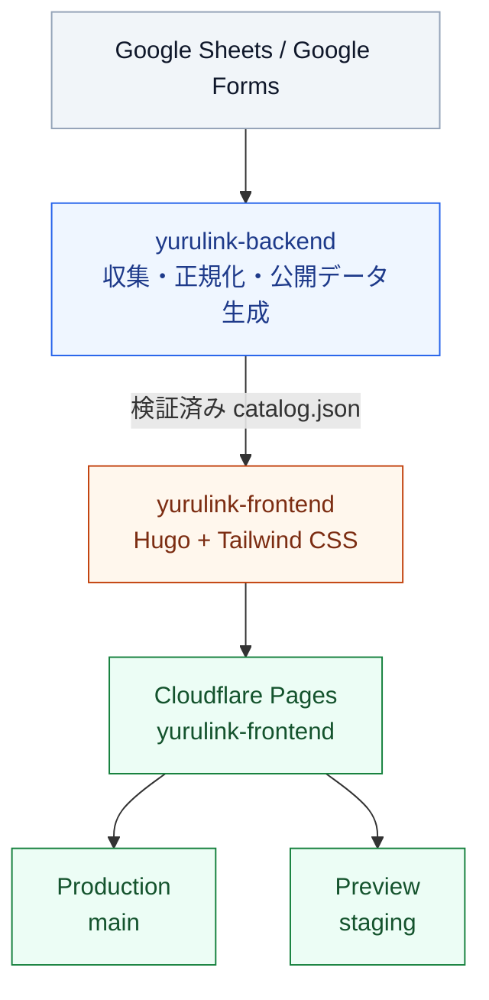

# YuruLink フロントエンド

YuruLinkは、関連番組の動画・プレイリスト・Webリンクなどを横断して探せる静的リンク集です。Backendが生成する統合公開カタログをHugoでビルドし、Cloudflare Pagesで配信します。

## システム構成



`data/public/catalog.json` は `schema_version: 2` の統合形式です。公開リンク実体 `items`、番組 `programs`、コレクション `collections` と、それらの多対多関係 `item_programs`・`memberships` を扱います。2026-11-19現在、`staging`にはGreen Book2由来3,176件とBook4の手動登録9件、計3,185件の統合カタログをBackend Actionsから配信済みです。Hugo・Cloudflare Preview・Playwright Chromium 8件の検証に成功しました。`main`/Productionへの反映および12時間の定期自動公開は未有効化です。

## 技術・機能

| 項目 | 構成 |
| --- | --- |
| サイト生成 | Hugo Extended 0.152.2 |
| ビルド | Node.js 22、npm |
| スタイル | Tailwind CSS v4 |
| 配信 | Cloudflare Pages |
| UI | PCサイドバー、モバイルドロワー、検索、カテゴリー絞り込み、並び替え、ページネーション、カード／リスト表示、テーマ切替 |
| 検証 | GitHub Actions、Smoke Test、Previewデプロイ確認、Playwright Chromium |

番組・プレイリストの表示順はカタログの `order` を参照し、プレイリストには取得できたチャンネル名を表示します。

## デプロイ環境

| ブランチ | Cloudflare Pages | URL |
| --- | --- | --- |
| `main` | Production | https://yurulink-frontend.pages.dev/ |
| `staging` | Preview | https://staging.yurulink-frontend.pages.dev/ |

`staging` の更新時にSmoke Test、コミットSHAに対応するPreviewデプロイの確認、Playwrightによるブラウザ検証を実行します。各テスト結果を確認し、承認後に本番へ反映します。

## ローカル実行

```sh
npm install
npm run build
```

開発サーバーは `npm run css:watch` と `hugo server` を別々のターミナルで起動します。

## 公開データ

YouTubeの収集データは公開品質検査に基づいて掲載します。外部フォーム投稿は審査・承認されたものだけを公開します。回答原本、管理メモ、認証情報は公開JSONに含めません。

## 仕様・運用資料

- [公開カタログ仕様](docs/public-catalog-contract-v2.md)
- [環境・デプロイ](docs/environments.md)
- [デザイン仕様](docs/design-system-phase2.md)
- [Backend](https://github.com/yurulinkdev/yurulink-backend)

## 主要なページ構成（2026-11-20）

| URL | 内容 |
| --- | --- |
| `/` | リンク集と検索・絞り込み。初回訪問のカテゴリ案内あり |
| `/about/` | 独立した「このサイトについて」。ページ下部に「記事・お知らせ」一覧 |
| `/about/<slug>/` | 記事・お知らせ単体 |
| `/help/` / `/help/search-guide/` | ヘルプ一覧と検索・絞り込みガイド |
| `/history/` / `/history/history-YYYY-MM/` | 月別更新履歴（本公開まで記事は作らない） |

旧`/news/welcome/`・`/posts/about/`・`/posts/search-guide/`は採用しません。PCでは左サイドバー、スマホでは画面左上のカテゴリドロワーからページに移動できます。トップの「おしらせ」はPCのみ表示します。

再生時間が**300秒未満**のYouTube動画はサイト内の「ショート」に分類し、「動画」カテゴリ・種類フィルタから除外します（YouTube公式Shortsの判定とは異なります）。再生時間による絞り込みは廃止し、再生時間の並び替えは維持しています。

## Hugo Templateの外部サービス設定

`hugo.toml`で、未設定の外部サービスは自動的に無効になります。Cloudflare Pagesへの依存なしに複数のブラウザ計測を組み込めます。

```toml
[params.social]
x = "https://x.com/YuruLinkDev"

[params.analytics]
# GA4測定ID。空欄なら同意UIも計測タグも出さない。
ga4_measurement_id = ""
# Cloudflare Web Analyticsの手動設定トークン。32桁の16進数。
cloudflare_web_analytics_token = ""
# New Relic Browser管理画面で発行された公式スニペット全体。
new_relic_browser_snippet = ""
```

GA4はユーザーの同意後のみ読み込みます。New Relic BrowserとCloudflare Web Analyticsは任意・独立に有効化できますが、ホスティング環境のビーコン自動挿入との重複、JavaScript実行負荷、CSP、プライバシー表示を確認してください。Productionの測定IDはStagingに流用しないことを推奨します。

## コンテンツの追加と管理文書

Instagramの公開投稿・リールは**フォーム等からの手動投稿のみ**。note記事とシリーズも分類対象です。分類の正本はBackend`config/taxonomy.v1.json`、Frontendの`data/taxonomy.json`はその複製です。公開前にSubmissionMasterで審査します。CSV一括投稿は別Book3タブから審査フローに連携する方式を検討中で、現時点で本稼働していません。

Google Driveの`YuruLink_Assets`には、ブランドの採用原本と`05-HTML-to-Image-Toolkit-20261120`版のZIP、OGPライト／ダークのPNGが保管されています。素材や制作ツールを変更する際は、Drive側の最新版配置・README更新・必要なマニフェスト更新も同時に行います。詳細はGoogle Drive`Project.md`の第20章と本リポジトリの以下の文書を参照してください。

- [フィードバック No.2](docs/frontend-feedback-20261120-no2.md)
- [計測サービス設計](docs/observability-evaluation.md)
- [SNS・note分類](docs/social-post-scope.md)
- [Backend CSV一括取込設計](https://github.com/yurulinkdev/yurulink-backend/blob/develop/docs/bulk-submission-import-design.md)

## Staging ChatOps（チャットからの検証）

`staging`は日常開発で継続利用します。GitHubの [`ops/requests/frontend-validation.json`](ops/requests/frontend-validation.json) を変更すると、同じWorkflow内で許可されたSmoke／Preview／Browser検証を直接実行します。**既存のコードPush／PR時の自動検証は維持**しています。対象CommitのSHAと実行結果を照合してから報告します。詳細は [Staging ChatOps運用手順](docs/staging-chatops.md) を参照してください。
