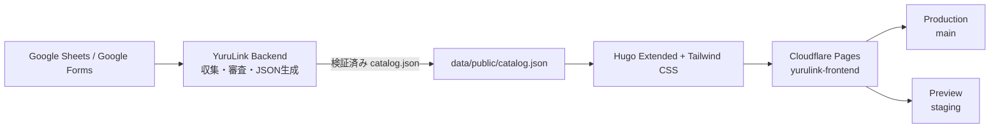

# YuruLink Frontend

YuruLinkは、関連番組の動画・プレイリスト・記事・Webサイト・SNSを横断して探せる**非公式のリンク集**です。公開カタログをHugoで静的サイトへ変換し、Cloudflare Pagesで配信します。

## システム構成



- 公開データは`schema_version: 2`の`catalog.json`です。`items`、`programs`、`collections`、`item_programs`、`memberships`の5つの配列でリンク・番組・コレクションの多対多関係を表します。
- Google Formsの回答原本、SubmissionMasterの審査メモ、未承認投稿、認証情報を公開HTML・JSONへ含めません。
- BackendのBlue／Greenデータ世代とFrontendのProduction／Previewは独立した切替単位です。

## 表示・操作

PCでは左サイドバー、スマートフォンでは左上のカテゴリドロワーを用意しています。検索、カテゴリ・種類・番組・日付・出演者による絞り込み、再生数・高評価数・再生時間等の並び替え、ページネーション、カード／リスト表示、テーマ切替を提供します。データが存在しない任意フィールドは未取得として扱い、値を推測して補いません。

ナビゲーションのトップレベルは**YouTube動画**と**その他サイト・SNS**で、「すべてのコンテンツ」を独立して配置します。ナビ分類は表示上の所属先であり、番組の公式性を自動認定するものではありません。YouTube動画のうち300秒未満はサイト内表示上「ショート」として扱いますが、YouTube公式Shorts認定とは異なります。

主なページ：

| URL | 内容 |
| --- | --- |
| `/` | リンク集、検索、フィルタ、並び替え |
| `/about/` | サイト概要、記事・お知らせ |
| `/help/`、`/help/search-guide/` | 操作方法 |
| `/submit/` | Google Formsによる掲載候補の投稿 |
| `/change-log/` | 公開された変更の月別履歴 |

## 技術とローカル実行

- Hugo Extended 0.152.2、Node.js 22、Tailwind CSS v4
- GitHub ActionsによるSmoke Test、Cloudflare PreviewデプロイSHA照合、Playwright Chromiumによるブラウザ検証
- テーマ・外部サービス・ブランド画像等の設定：`hugo.toml`
- 分類定義：`data/taxonomy.json`（Backendの`config/taxonomy.v1.json`を正本とする複製）

```sh
npm install
npm run build
```

開発中は`npm run css:watch`と`hugo server`を別ターミナルで起動します。

## デプロイと公開判断

| ブランチ | Pages環境 | URL |
| --- | --- | --- |
| `main` | Production | https://yurulink-frontend.pages.dev/ |
| `staging` | Preview | https://staging.yurulink-frontend.pages.dev/ |

Cloudflare Pagesは**単一の`yurulink-frontend`プロジェクト**を使用します。`staging`の設定は`noindex`と開発向け`baseURL`を含むため、`main`へ取り込む際には環境別のHugoビルド設定、canonical／OGP、検索エンジン制御を検証します。コードのマージが自動デプロイを起動する可能性を前提に扱い、Production反映・DNS変更は事前承認を要します。

## 詳細仕様

- [公開カタログのデータ契約](docs/public-catalog-contract-v2.md)
- [カテゴリ・性能要件](docs/frontend-refactoring-performance-category-20261122.md)
- [UI・操作の回帰契約](docs/frontend-ui-regression-contract-20261122.md)
- [デザインシステム](docs/design-system-phase2.md)
- [環境・デプロイ](docs/environments.md)
- [Staging ChatOpsの検証手順](docs/staging-chatops.md)
- [Google Forms埋め込み](docs/submission-embed-staging.md)
- [計測サービスの設定](docs/observability-evaluation.md)
- [Backendリポジトリ](https://github.com/yurulinkdev/yurulink-backend)
