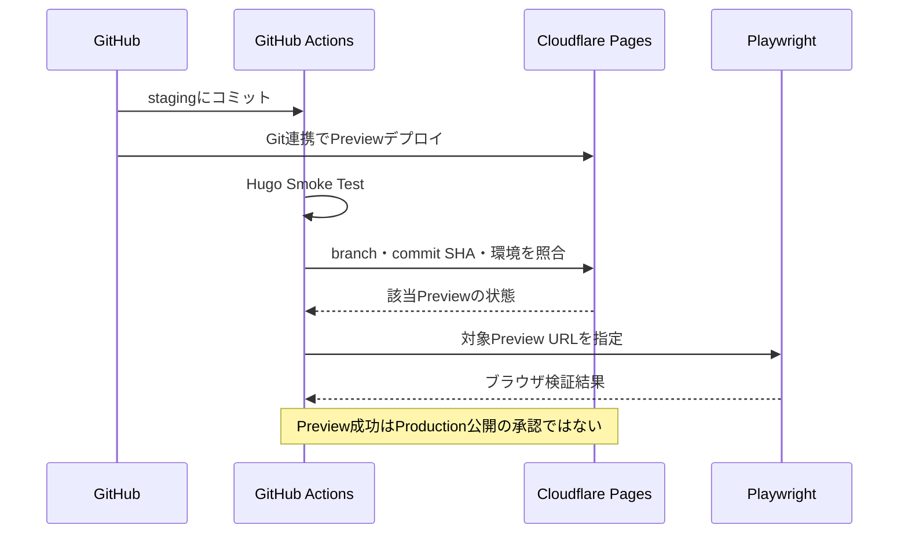

# Frontendの環境・ビルド・公開検証

## 環境構成

Cloudflare Pagesは`yurulink-frontend`という**単一プロジェクト**で運用し、GitブランチをProduction／Previewへ対応させます。

| 用途 | Gitブランチ | Pages環境 | 既存ホスト |
| --- | --- | --- | --- |
| 公開版 | `main` | Production | https://www.yurulink.com/ |
| 検証版 | `staging` | Preview | https://staging.yurulink.com/ |
| 個別変更の確認 | PR等のブランチ | Preview | デプロイ固有URL |

2026-11-23、Cloudflare PagesのCustom Domainとして`www.yurulink.com`と`staging.yurulink.com`を登録しました。両DNSレコードはプロキシ有効。`*.pages.dev`の旧ホスト名は接続維持し、ブラウザー向けcanonical/OGPは独自ドメインを正本とします。ProductionとStagingのTLS・検索インデックス制御は別々に確認します。

## ビルド仕様

- Node.js 22、Hugo Extended 0.152.2、Tailwind CSS v4
- ビルドコマンド：`npm run css:build && hugo --minify`
- 出力ディレクトリ：`public`
- 依存関係：Lockfileがある場合は`npm ci`、ない場合は`npm install`を選択
- Hugoの設定入口：`hugo.toml`、`assets/css/`、`layouts/`

`staging`には`noindex=true`とPreview URL用`baseURL`を設定しています。Productionへ同じ設定をそのまま持ち込むと、canonical・OGP・robots等が不適切になります。**本番反映前にブランチ／ビルド環境別に`baseURL`・検索制御・計測ホスト条件を切り替え、Cloudflare側の実ビルド設定と一致させます。**

## サービスの相互作用

## 検証の必須条件

1. **コードとJSON**：現行の公開データ契約、分類定義、必要なプログラムを同じコミットに含める。
2. **Smoke**：Hugoビルド、リンク、基本ページ、404、公開データの構造を確認する。
3. **Preview**：`scripts/wait-cloudflare-pages.py`でブランチと対象コミットSHAの一致したデプロイを検査する。以前の別SHAの成功を流用しない。
4. **ブラウザ**：Playwright Chromiumで検索・ナビ・カテゴリ保存・ページネーション・カード／リスト・投稿導線を検査する。
5. **本番反映前**：Production環境用のビルド設定、noindex解除の妥当性、canonical／OGP、GA4同意・ホスト制限、公開対象JSONを確認する。

`staging`から`main`へのマージはコード変更だけでなくPages Productionの自動デプロイを伴い得る操作です。事前承認なしに実施しません。BackendのBlue／Green有効世代、初回データ公開、DNS切替も独立した承認対象です。

## 検証の起動方法

通常のコードPushに対するSmoke・Preview・ブラウザ検証を維持しています。チャットからの限定された追加検証は`ops/requests/frontend-validation.json`を入力とする同一Workflow内Jobで行います。使用可能なアクション、JSONの書式、結果と対象SHAの照合は[Staging ChatOps](staging-chatops.md)に従ってください。

障害時には前回検証済みのデプロイまたはGitコミットへ復旧します。複数のCloudflare Pagesプロジェクトに同一Gitブランチを接続するとデプロイが重複するため、運用台帳では接続先・Custom Domain・環境変数を確認します。

### Preview／ProductionのOGP分離（2026-11-23）

- 本体の正式OGPは `static/ogp/yurulink-light.png`。StagingおよびPagesの非mainブランチPreviewだけ `static/ogp/yurulink-staging.png`（右上にSTAGING表示）を使います。
- 設定値は `config/staging/hugo.toml` と `config/production/hugo.toml` の `params.og_image`。Hugoの `--environment staging|production` で明示切替できます。
- Cloudflare Pagesではビルド時の `CF_PAGES_BRANCH` を `head/meta.html` が参照してカードを切り替えます。既存Cloudflareビルドコマンドに変更を加える必要はありません。ブランチ `main` は正式版、それ以外は検証版。環境変数の読取許可を `hugo.toml` の `security.funcs.getenv` に限定追加しました。
- この改修は**OGPのみ**を自動分岐します。URL・canonical・`noindex` 等の環境分離とカスタムドメイン接続は従来の確認・承認境界を維持し、mainへ同期する際に別途点検します。
- 画像は採用済みのHTML-to-Imageライト版にHTML/CSSで検証ラベルを合成し、Playwright Chromiumで1200×630 PNGに描画。生成AIの新規画像生成はしません。制作原本・配布物はAutomationLabとDrive `YuruLink_Assets/05-HTML-to-Image-Toolkit-20261120` に同期します。

### Production初期公開のビルド・受付ゲート（2026-11-23・独自ドメイン接続前の履歴）

現時点でCloudflare Pages `yurulink-frontend` の `domains` 一覧に登録されているのは `yurulink-frontend.pages.dev` のみです。PagesのProduction branchは`main`、Previewは`staging`。独自ドメイン `www.yurulink.com` はPagesのCustom Domainに未登録のため、最初のProduction公開では既存のPagesホストをcanonical/OGPに採用し、独自ドメイン接続後に切り替えます。

Pagesの既存コマンド `npm run css:build && hugo --minify` は変更せず、`css:build` 冒頭の `scripts/prepare-site-build.mjs` が `CF_PAGES_BRANCH`（Actionsは`GITHUB_REF_NAME`）を読み、ビルド作業ディレクトリ内の `hugo.toml` を環境に応じて更新します。GitHubリポジトリの元ファイルは更新しません。

- `main`: `baseURL=https://yurulink-frontend.pages.dev/`、`params.noindex=false`。投稿審査の全体E2Eが未完了のため、フォーム埋め込み・投稿リンクは無効化します。
- `staging`／各Preview: `baseURL=https://staging.yurulink-frontend.pages.dev/`、`params.noindex=true`。検証フォームは有効のままです。
- OGPの`STAGING`ラベルは既存の`head/meta.html`と`config/staging/hugo.toml`に従い、上記URL切替と両立します。URLと画像の両方を混同しないようにします。
- ローカル再現：`YURULINK_SITE_TARGET=production npm run build` ／`YURULINK_SITE_TARGET=staging npm run build`。CIは`scripts/verify-site-environments.mjs`で両方の生成HTMLを検査します。

公開後のGoogle Form受付再開には、回答受付・Book3→SubmissionMaster→Book4審査の実動作確認が必要です。Discord通知・DNS・旧独立Staging Pagesプロジェクトの削除は今回の同期対象に含めません。

### Cloudflare旧独立Staging削除・GitHub Actions DNS権限検証（2026-11-23）

- 現行Pages: `yurulink-frontend`。Productionホスト `https://yurulink-frontend.pages.dev/` と同一PagesプロジェクトのPreview `https://staging.yurulink-frontend.pages.dev/` を継続使用する。
- 廃止した**別プロジェクト**: `yurulink-frontend-staging`（旧 `yurulink-frontend-staging.pages.dev`）。Cloudflare APIで名前・ID・ホスト・独自ドメインなしを照合し、最初の559件のデプロイ履歴から480件を個別削除、残り79件でプロジェクトを削除した。削除後のAPI 404と現行PagesのID不変を検証。証跡: [GitHub Actions Run 45087253709](https://github.com/yurulinkdev/yurulink-frontend/actions/runs/45087253709)。
- GitHub Secret `CLOUDFLARE_API_TOKEN` は**アカウント用トークン**。トークン確認は `GET /accounts/{account_id}/tokens/verify` でActive、Pages API・`yurulink.com` Zone/DNS Recordsの読み取り成功。[権限確認Run 45086959628](https://github.com/yurulinkdev/yurulink-frontend/actions/runs/45086959628)。
- DNSの実Write確認: GitHub Actionsから一意な専用TXTレコードを作成し、内容をAPIで読み戻し、削除し、検索結果0件まで再検証した。**既存DNSレコードは変更していない**。[DNS実操作Run 45087468057](https://github.com/yurulinkdev/yurulink-frontend/actions/runs/45087468057)。
- 削除およびDNS試験用の一回限りの特権Workflow・操作要求・実装スクリプトは完了後にリポジトリから削除。読み取り専用棚卸しWorkflowは保持し、旧プロジェクトがHTTP 404の場合を正常な廃止済み状態として記録する。
- 現行トークンはPages Writeがアカウント全体、DNS/Zone Writeが`yurulink.com`に付与され、有効期限なし。今後、運用上必要な権限だけに分離した短期有効のPages用／DNS用トークンへの切り分けを推奨する。Secret値をコード・ログ・文書に記録しない。
- `www.yurulink.com`のPages Custom Domain接続・DNSの本番変更は今回実行していない。

### Custom Domain切替の実施（2026-11-23・現行）

- Cloudflare Pages `yurulink-frontend` 1プロジェクトへ `www.yurulink.com`（`main` Production）と `staging.yurulink.com`（`staging` Preview）をCustom Domain登録し、API検証で両ドメイン `active` を確認。
- Cloudflare DNS（Zone `yurulink.com`）のCNAME：`www` → `yurulink-frontend.pages.dev`、`staging` → `staging.yurulink-frontend.pages.dev`。どちらも `proxied=true`。登録・DNS更新後の読み戻し確認済み。
- `scripts/prepare-site-build.mjs` のブランチ別 `baseURL` を各独自ドメインへ変更。`scripts/verify-site-environments.mjs` の期待canonical/OGPも変更。`hugo.toml` の初期baseURLはStaging独自ドメイン。
- Productionは検索エンジン登録許可（`noindex=false`）、Stagingは非登録（`noindex=true`）。Productionのフォーム投稿導線は審査系の全体動作確認が終わるまで無効、Stagingは有効のまま。
- 作業用のCloudflare操作は固定ホスト名・事前チェック・差分のみ変更・変更後の読み戻しで制御。`ops/requests/cloudflare-domains-20261123.json` と専用Workflow、GitHubの `ops/cloudflare-domain-status-20261123` ブランチに検査報告を保存。検証完了後は一時的な書込み権限を再点検する。
- 旧 `*.pages.dev` 正本を記した上記の同日初期公開セクションは**接続前の履歴**であり、現行のホスト設定は本節が優先。
