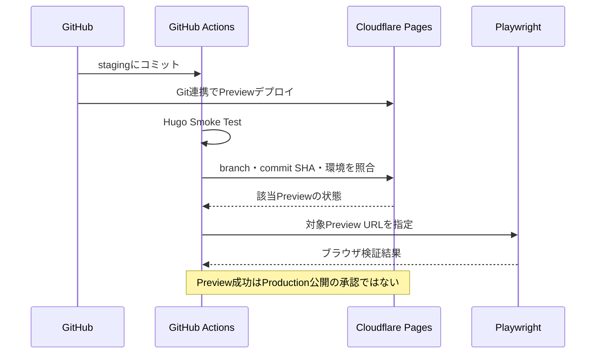

# Frontendの環境・ビルド・公開検証

## 環境構成

Cloudflare Pagesは`yurulink-frontend`という**単一プロジェクト**で運用し、GitブランチをProduction／Previewへ対応させます。

| 用途 | Gitブランチ | Pages環境 | 既存ホスト |
| --- | --- | --- | --- |
| 公開版 | `main` | Production | https://yurulink-frontend.pages.dev/ |
| 検証版 | `staging` | Preview | https://staging.yurulink-frontend.pages.dev/ |
| 個別変更の確認 | PR等のブランチ | Preview | デプロイ固有URL |

カスタムドメインを接続する場合は、ProductionとStagingのURL・DNS・TLS・検索インデックス制御を別々に検証します。想定する公開用ホストは`www.yurulink.com`、Staging用は`staging.yurulink.com`ですが、実接続済みかどうかはCloudflareの現在設定で確認してください。

## ビルド仕様

- Node.js 22、Hugo Extended 0.152.2、Tailwind CSS v4
- ビルドコマンド：`npm run css:build && hugo --minify`
- 出力ディレクトリ：`public`
- 依存関係：Lockfileがある場合は`npm ci`、ない場合は`npm install`を選択
- Hugoの設定入口：`hugo.toml`、`assets/css/`、`layouts/`

**2026-11-23実装**：Cloudflare Pagesの既存ビルドコマンド `npm run css:build && hugo --minify` は変更しません。`npm run css:build` の先頭で `scripts/prepare-site-build.mjs` を実行し、Pages標準変数 `CF_PAGES_BRANCH` を判定します。デフォルトはStaging安全側です。GitHub Actionsは `GITHUB_REF_NAME`、ローカル確認は `YURULINK_SITE_TARGET=production|staging` を使用できます。ビルド作業ディレクトリの `hugo.toml` だけを書き換え、GitHub上の設定ファイルは変更しません。

| ビルド判定 | canonical/OGP用baseURL | robots設定 | 投稿フォーム |
| --- | --- | --- | --- |
| main / production | `https://yurulink-frontend.pages.dev/` | index許可 | **一時停止**（Backendの審査E2E待ち） |
| staging / Preview / 不明 | `https://staging.yurulink-frontend.pages.dev/` | noindex | 既存の検証用フォームを維持 |

`www.yurulink.com`へのPages Custom Domain接続・TLS・DNS・リダイレクトが未検証なので、初回main同期時点では既存のPages Productionホストを正規URLにします。接続確認後にProduction baseURLを `https://www.yurulink.com/` に変更し、GA4のホスト許可とOGP・canonical・robotsを再検証します。外部URLの現在の稼働を推測で確定扱いしません。

`scripts/verify-site-environments.mjs` でProduction/Previewの両方を静的ビルドし、canonical・OGP・noindex・投稿フォームの非公開化・Welcome分離をCIで検証します。

## サービスの相互作用

## 検証の必須条件

1. **コードとJSON**：現行の公開データ契約、分類定義、必要なプログラムを同じコミットに含める。
2. **Smoke**：Hugoビルド、リンク、基本ページ、404、公開データの構造を確認する。
3. **Preview**：`scripts/wait-cloudflare-pages.py`でブランチと対象コミットSHAの一致したデプロイを検査する。以前の別SHAの成功を流用しない。
4. **ブラウザ**：Playwright Chromiumで検索・ナビ・カテゴリ保存・ページネーション・カード／リスト・投稿導線を検査する。
5. **本番反映前**：Production環境用のビルド設定、noindex解除の妥当性、canonical／OGP、GA4同意・ホスト制限、公開対象JSONを確認する。

`staging`から`main`へのマージはコード変更だけでなくPages Productionの自動デプロイを伴い得る操作です。事前承認なしに実施しません。BackendのBlue／Green有効世代、初回データ公開、DNS切替も独立した承認対象です。

## 検証の起動方法

通常のコードPushに対するSmoke・Preview・ブラウザ検証を維持しています。チャットからの限定された追加検証は`ops/requests/frontend-validation.json`を入力とする同一Workflow内Jobで行います。使用可能なアクション、JSONの書式、結果と対象SHAの照合は[Staging ChatOps](staging-chatops.md)に従ってください。

障害時には前回検証済みのデプロイまたはGitコミットへ復旧します。複数のCloudflare Pagesプロジェクトに同一Gitブランチを接続するとデプロイが重複するため、運用台帳では接続先・Custom Domain・環境変数を確認します。
