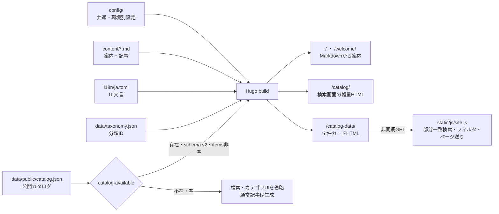

# Hugoテンプレート構成・文言管理・カタログ依存境界

## 目的と適用範囲

YuruLink Frontendは、Hugoの静的サイトを基盤として、記事・案内と公開リンク検索を提供する。本文、共通UIの文言、ブランド設定、公開データの役割を分離し、`catalog.json`がない状態でもHugoの一般ページを生成できるようにする。

対象：`yurulinkdev/yurulink-frontend`の`staging`。設計の基準は2026-11-23時点のHugoテンプレートと検索JavaScriptである。

## データとテンプレートの対応

| 管理対象 | 正本・設定箇所 | 出力への反映 |
| --- | --- | --- |
| サイトタイトル、ブランドSVG、ファビコン、Apple Touch Icon、OGP、説明文 | `config/_default/hugo.toml` の `title`、`params.brand_logo`、`params.favicon_*`、`params.og_*`、`params.description` | ヘッダー、サイドバー、HTML `head`、フッター |
| ようこその案内本文・眉見出し | `content/welcome/_index.md` | `/` と `/welcome/`。共通部分テンプレートが `Site.GetPage "/welcome"` で参照 |
| 「このサイトについて」、ヘルプ、投稿案内など | `content/<section>/*.md` | Hugoの各セクション・記事ページ |
| ボタン、メニュー、検索・並び替えの短い文言 | `i18n/ja.toml` | Goテンプレートの `i18n`。JavaScriptには `site/ui-translations.html` 経由で渡す |
| YouTube対象の表示分類、投稿カテゴリID | `data/taxonomy.json`（Backend `config/taxonomy.v1.json` の複製） | カテゴリーツリー。表示名は翻訳テーブル側に分離 |
| 公開リンク、番組、プレイリスト、所属関係 | `data/public/catalog.json` | Hugoが `/catalog-data/` に全件カードHTMLを生成 |
| カタログの公開差分・月別更新履歴 | `content/change-log/YYYY-MM.md` | `/change-log/YYYY-MM/` と、サイドバー下部の日付別・種類別件数 |
| 計測、Googleフォーム、SNSのURL | `config/_default/hugo.toml` の `params.analytics`、`params.submission`、`params.social` | 設定が有効で、指定した条件を満たす場合のみ出力 |

`layouts/index.html`と`layouts/welcome/list.html`は同じ`site/welcome.html`を参照する。案内文の重複管理を避けるため、本文はMarkdownの`.Content`から描画する。

## ページ生成と検索の流れ

実際の検索処理はブラウザでJSONを直接パースする方式ではない。**HugoがJSONを読み込みカードHTMLを生成**し、`site.js`が`/catalog-data/`のHTMLから`data-catalog-item`を読み取る。全件要素は`template`内に保持し、通常DOMへ追加するカードは1ページ分（20／50／100件）に限定する。

検索はタイトル・説明等の部分一致で、複数語を自動でAND分割しない。カテゴリ・種類・日付・出演者の条件は検索ロジックで組み合わせる。URLの`q`、`category`、`types`、`sort`、`page`等を保持する。公開データのスキーマ契約は[公開カタログ仕様](public-catalog-contract-v2.md)を参照する。

## 公開JSONがない場合

`layouts/partials/site/catalog-available.html`が、次のすべてを満たした場合のみカタログを有効にする。

1. `.Site.Data.public.catalog`が存在する。
2. `schema_version`が数値`2`である。
3. `items`が空ではない。

条件を満たさないときは、`/catalog/`と`/catalog-data/`の検索・カード表示を生成しない。ヘッダー内の検索欄、サイドバー内のカテゴリー・番組ツリー、ようこその「すべてのコンテンツ」ボタンも非表示にする。全件取得用`site.js`とカテゴリ操作の初回ガイドも読み込まない。

サイトヘッダー、サイドバーの一般ページ案内、フッター、`/about/`、`/help/`、`/submit/`、`/change-log/`などは通常どおり生成する。**入力JSON自体が構文不正の場合はHugoのビルドエラーとして扱う。** 書式検査と空データの配信拒否はBackendの責務である。

## 言語と表示内容の分離

- 長い文章は`content/welcome/_index.md`などのコンテンツに置く。将来の言語追加では、Hugoの翻訳コンテンツとして言語別Markdownを用意する。
- 共通UIの短文は`i18n/ja.toml`のキーで参照する。別言語は`i18n/<lang>.toml`を追加する。実際に言語を公開する場合はHugoの`languages`、ルーティング、canonical・`hreflang`、対象言語のコンテンツを併せて設定・検証する。
- 分類ID、`browse:*`、JSONのキーと列挙値、API識別子は言語によらず維持する。Backendが配信する名称は固有名詞・分類データとして扱い、多言語用の表示名はIDをキーに別定義する。
- ブラウザ実行時の短文は`site/ui-translations.html`が埋め込むJSONを`site.js`、`onboarding.js`、`ga4-consent.js`で参照する。単体DOMフィクスチャで翻訳データが省略されたときは、現行日本語のフォールバックを使用する。
- `config/_default/hugo.toml`の`params.og_locale`とサイト説明、OGPの代替テキスト等も言語別に管理できる。ブランド画像そのものは共通の承認済み素材を参照する。

**現時点の対応範囲**：日本語（`ja`）を基準にUIと本文を分離した。別言語の翻訳本文・翻訳テーブル・運用テストは未実装である。

## ブランドとビルド環境

`title`・`params.brand_logo`・`params.favicon_svg`・`params.favicon_png`・`params.apple_touch_icon`はサイト全体の共通設定である。HTMLの`head`はこれらのパスを参照し、OGP画像は`og_image`と`og_staging_image`を使い分ける。

`scripts/prepare-site-build.mjs` は `CF_PAGES_BRANCH` を基準に `config/main/hugo.toml` または `config/staging/hugo.toml` を選び、旧Pagesコマンド向けに追跡対象外の `config/production/hugo.toml` を生成する。環境値の正本・DNSは変更しない。

Backendが検証済み`catalog.json`をFrontend `staging`と`main`の`data/public/catalog.json`へ自動配信する処理は、既存サイトの**定期コンテンツ更新**である。データのみの更新は毎回の個別承認を要しない。Hugoテンプレート・JavaScript・設定を`main`へ変更する行為、初回Production公開、DNS・Pages設定の変更、Backend Blue／Green切替は別途承認を要する。JSONだけのコミットでもCloudflare Pagesの自動ビルドが起動し得る。

## 変更と検証

- 通常ビルド：`npm run build`。`scripts/smoke-test.sh`はJSONあり・なしのHugo生成と主要URLを検査する。
- コード変更時は`node --check static/js/site.js`とHugo Smokeを実施する。変更した翻訳キーは出力HTML・ブラウザ画面で照合する。
- `tests/browser/deferred-catalog-20261123.spec.mjs`などで、Welcomeと検索ページの分離、カタログの遅延取得、カテゴリ操作、初回表示を検証する。
- 正式な多言語公開前に、翻訳キーの欠損、言語切替、検索キーワードの正規化・並び順、日付・数値表示、スクリーンリーダー用文言、OGPロケールを検証する。
- 同じコミットSHAについてSmoke・Pages Preview・Playwrightの結果を確認する。GitHub ActionsのJob成功はProductionサイトでの表示検証とは別に記録する。

関連：[Frontend環境とデプロイ](environments.md)／[初期表示・ページ境界](frontend-initial-render-performance-20261123.md)／[UI回帰仕様](frontend-ui-regression-contract-20261122.md)。

## 更新履歴の生成

Backendのカタログ配信処理は、Frontendブランチにある直前の公開JSONと生成済みJSONの差分を計算する。掲載内容に変更があるときは、公開JSONと当月のMarkdownを同じGitコミットで更新する。月別記事は`date`、`last_update`、`latest_summary`を持つ。Backendが当月のMarkdownを再生成し、`## WeekN`の下に`### YYYY-MM-DD`と「カテゴリ：タイトル」の全件明細を配置する。月初を含む週をWeek1とし、JSTの月曜00:00に週番号を増やす。週・日とも新しい順。同じ日付の明細は同じ見出しにまとめる。月が変わると別ファイルのWeek1に切り替える。

`/change-log/`の月別一覧は`daily_summaries`の日付と種類別件数を表示する。サイドバーは全月の`daily_summaries`から最新5日を表示する。例：`2026-11-24：動画2件 / リンク1件追加`。日付リンクは月別記事の日付見出しへ遷移する。旧形式の月別記事は移行まで`last_update`と`latest_summary`を使用する。統計値だけが変わった場合は、更新履歴に新しい項目を作らない。未公開の記事・架空の初回公開記録は生成しない。

更新履歴の書込範囲、障害時の扱い、検証事項はBackendの[公開差分・更新履歴配信設計](https://github.com/yurulinkdev/yurulink-backend/blob/develop/docs/catalog-changelog-publication.md)を参照する。

動画タイトルは公開カタログのYouTube URLを参照するMarkdownリンクとして生成する。日別件数はBackendが同日の明細を集計し、動画・プレイリスト・その他リンクを区別する。月別記事の冒頭に旧説明文は出力しない。掲載終了した動画や移行時にURLが特定できない旧明細は、誤ったリンクを生成しない。
