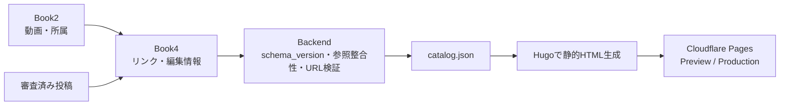

# YuruLink公開カタログ仕様 — schema_version: 2

## 目的と適用範囲

Frontendは`data/public/catalog.json`にある**検証済みの統合形式JSON**を読み込み、リンク実体、番組、プレイリストやテーマ、これらの多対多関係を表示します。`schema_version: 2`は互換性識別子として維持します。

分類は相互に独立した軸です。

- `kind`：何のコンテンツか（動画、記事、サイト、SNS等）
- `platform`：どのプラットフォームに掲載されているか
- `provenance`：確認された出自・公式性の基本分類
- `category_id`：審査・分類したコンテンツの葉ID（任意）
- `video_format`：Backendが収集した動画形式の属性
- `channel_group`：Book1由来のチャンネルの**ナビ表示分類**

投稿者がフォームで「公式」を選んでも`provenance=official`や`officiality_verified=true`に自動変換しません。

## 最上位オブジェクト

| キー | 型・主な必須項目 | 用途 |
| --- | --- | --- |
| `schema_version` | 数値`2` | 形式識別子 |
| `generated_at` | ISO 8601日時 | スナップショット生成時刻 |
| `items` | 配列。`id`、`title`、`url`、`kind`、`platform`、`provenance`、`status` | リンク実体 |
| `programs` | 配列。`id`、`name` | 番組・活動・チャンネル表示情報 |
| `collections` | 配列。`id`、`title`、`kind` | プレイリスト・テーマ・編集集合 |
| `item_programs` | 配列。`item_id`、`program_id` | リンクと番組の多対多関係 |
| `memberships` | 配列。`item_id`、`collection_id` | リンクと集合の多対多関係 |

`programs`には`description`、`parent_id`、`order`、`channel_group`等、`collections`には`program_id`、`parent_id`、`description`、`order`、`channel_name`等を任意に持てます。`memberships.position`が取得できる場合は所属内の並び順に使用できます。

`items`の任意フィールド例：`description`、`thumbnail_url`、`published_at`、`updated_at`、`tags`、`category_id`、`view_count`、`like_count`、`duration_seconds`、`statistics_fetched_at`、`video_format`、`video_format_source`、`video_relation`、`person_ids`、`avatar_url`、`profile_bio`。欠損したフィールドを数値ゼロや未確認の人物・公式性で補いません。

### 列挙値・取り扱い

- `items[].kind`：`video`、`article`、`website`、`tool`、`social_profile`、`social_post`、`podcast_episode`、`other`
- `items[].platform`：`youtube`、`x`、`instagram`、`note`、`spotify`、`web`、`other`
- `provenance`：`official`、`community`、`unknown`。名前やドメイン名だけで公式性を推測しない
- `status`：`published`、`unlisted`。公開JSONには`published`のレコードのみ含める
- `collections[].kind`：`playlist`、`topic`、`curated`
- `video_format`：`video`、`short`、`live`。サイト内で300秒未満を「ショート」と表示するUI規則とは別物

## JSONの構造例

```json
{
  "schema_version": 2,
  "generated_at": "2026-11-22T00:00:00Z",
  "programs": [{"id": "program:example", "name": "番組A", "order": 10}],
  "collections": [{"id": "collection:example", "title": "プレイリストA", "kind": "playlist"}],
  "items": [{"id": "youtube:example", "title": "動画A", "url": "https://www.youtube.com/watch?v=example", "kind": "video", "platform": "youtube", "provenance": "unknown", "status": "published"}],
  "memberships": [{"item_id": "youtube:example", "collection_id": "collection:example"}],
  "item_programs": [{"item_id": "youtube:example", "program_id": "program:example"}]
}
```

この例は構造説明のための架空データです。

## 生成・検証・配信



- URLは原則HTTP(S)のみ、画像URLは許可ホスト・安全性を検査します。
- IDは配列ごとに一意、`item_programs`／`memberships`の参照先は実在すること、所属重複と親階層の循環がないことを検査します。
- 非公開ステータス、未承認フォーム回答、個人情報、審査メモ、認証情報を出力しません。
- `order`はBook1等の管理順に従い、同値では名称順を用います。`channel_name`が取得できるプレイリストのみチャンネル名を表示し、推測で架空の所属を作りません。
- BackendによるArtifact生成、Frontendの`staging`配送、`main`／Production公開は別ゲートです。単にJSONを生成したことを公開完了としません。

## 表示と検索の契約

- ナビの正本はBackend`config/taxonomy.v1.json`の`navigation`で、Frontend`data/taxonomy.json`へ同期します。上位カテゴリは「YouTube動画」と「その他サイト・SNS」、それとは独立して「すべてのコンテンツ」を表示します。
- `programs[].channel_group`（`official`／`related`／`other`）はチャンネルのナビ配置先です。これだけで公式性を証明しません。各チャンネル内には動画・プレイリスト・ショート・ライブの下位導線を持てます。
- `browse:*`はFrontend固有の仮想フィルタIDであり、JSONの`items[].category_id`に保存しません。
- 検索はタイトル、説明、掲載先、カテゴリ、関連番組名の部分一致を基本とし、URLの`q`で共有可能です。種類フィルタ`types`、カテゴリ`category`、日付`date_field`・`from`・`to`、出演者`people`、並び順`sort`を組み合わせます。
- 出演者の公開可能な情報がある場合だけ`people[]`と`items[].person_ids[]`で表し、未確認の出演者や関係は生成しません。
- 再生数／高評価数は取得時点のスナップショットであり、リアルタイム値ではありません。非負の安全な整数を扱い、未取得を`0`と混同しません。`sort=views-desc`／`views-asc`は未取得と非対象リンクを末尾に置きます。
- Frontendの`formatOf(record)`は、再生時間300秒未満のYouTube動画を画面上の「ショート」と扱います。`video_format`や`video_format_source`を逆書込みしません。300秒ちょうどはこの時間条件によるショートではありません。
- 投稿日・更新日は`published_at`／`updated_at`を区別し、画面表示・日付フィルタには`Asia/Tokyo`の境界を使います。`statistics_fetched_at`はコンテンツ更新日ではありません。
- Instagram公開投稿・リールは`kind=social_post`／`platform=instagram`、noteの記事・シリーズは`kind=article`／`platform=note`で区別できます。一般公開投稿は管理者審査を経由します。

## 関連契約

- [カテゴリ構造・性能](frontend-refactoring-performance-category-20261122.md)
- [UI・ナビゲーション回帰](frontend-ui-regression-contract-20261122.md)
- [Backend Book4のデータ契約](https://github.com/yurulinkdev/yurulink-backend/blob/develop/docs/book4-public-catalog-plan.md)
- [Backendコンテンツ分類](https://github.com/yurulinkdev/yurulink-backend/blob/develop/docs/content-classification-policy.md)
