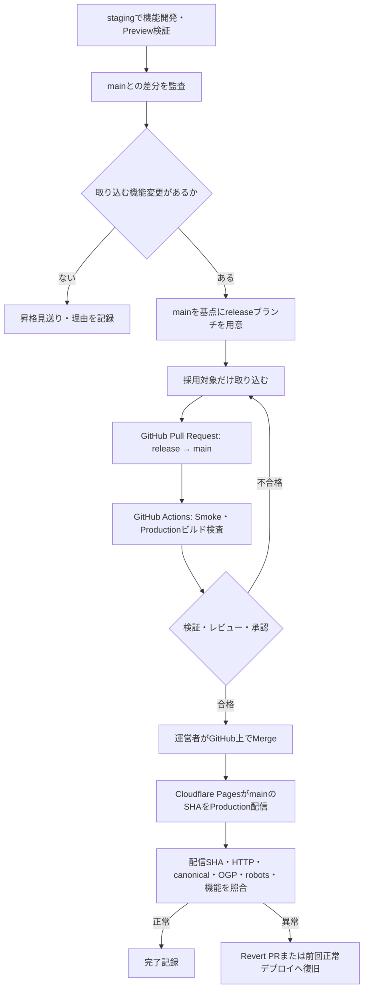

# Frontend staging → main 昇格運用設計（GitHub標準機能、ChatGPT非依存）

- 状態：設計案。GitHub側の保護ルール適用と本番コード昇格は未実施。
- 対象：`yurulinkdev/yurulink-frontend`
- 記録日：2026-11-23
- 関連：[同日時点の差分監査](./staging-main-diff-audit-20261123.md)、[現行環境仕様](./environments.md)

## 結論

**運営者がGitHubのPull Request画面で昇格を承認・実行し、GitHub Actionsが検証、Cloudflare Pagesが`main`のコミットを自動配信する。** ChatGPTはこの経路の必須構成要素にしない。PRの承認主体は運営者とし、通常のコード更新を無人でProductionへ昇格させない。

定期 `catalog.json` 配信は独立経路とする。データ更新のたびに人手でPRを承認する運用にはしない。ただし、`main`保護ルールに例外を導入する方式は別途設計し、実際の権限を確認してから設定する。

## 現行構成で確認できたこと

- `main`：Cloudflare Pages `yurulink-frontend` のProduction、`https://www.yurulink.com/`。
- `staging`：同一PagesプロジェクトのPreview、`https://staging.yurulink.com/`。
- `.github/workflows/frontend-smoke.yml` は `pull_request` と `main`／`staging`のPushで実行する。Job名は `smoke`。実際のRequired Checkとして登録されているかは未確認。
- `.github/workflows/cloudflare-preview-verify.yml` はStaging Pushを起点にPreviewの対象SHAを検証する。現行設定ではPR一般の必須チェックではない。
- `.github/workflows/staging-browser.yml` はStaging／Main PushでChromium E2Eを行うが、現行設定のイベントに `pull_request` はない。**現状のままPRの必須チェックとして指定すると、そのPRにチェックが作成されず保留となる可能性がある。**
- `scripts/prepare-site-build.mjs` はビルド時に環境別 `baseURL`、`noindex`、投稿フォーム有効性を切り替える。生成HTMLは `scripts/verify-site-environments.mjs` で検査する。
- 2026-11-23のUI昇格PR [#28](https://github.com/yurulinkdev/yurulink-frontend/pull/28)はマージ済み。現時点の差分監査で新たに昇格すべきUI変更は確認していない。

## 推奨フロー



### 1. 変更対象の選定

担当：開発者または運営者。GitHubのBranches／Compareで `main` と `staging` の現在SHAを記録し、二点比較でファイル内容差分、三点比較で導入予定コミットを調べる。

`hugo.toml`の環境固有値、Cloudflareの一回限りの要求JSON、Mainの独自ドメイン運用コードは、そのままコピーしない。`data/public/catalog.json`の定期更新もPRから分離する。必要なUI・Hugo・テスト・共通データ契約だけを昇格対象として列挙する。

### 2. GitHub標準PRの作成（最小運用）

軽微で差分が明確な場合は、GitHubの **Pull requests → New pull request** で `base: main`、`compare: staging` を指定する。`Files changed` を確認し、Production用設定を上書きしないことを確認してからPRを作成する。

両ブランチの履歴が分岐している場合は、PR表示に既にMainへ取り込んだ機能の差分が再出現することがある。この場合は次のReleaseブランチ方式を採用する。競合が出た場合はGitHubのConflict editorまたはGit CLIで解消する。

### 3. Releaseブランチ方式（履歴分岐時の標準）

実行者：ローカルGit／GitHub CLIに権限を持つ運営者。次はサンプルであり、`<commit-sha>` は実際に昇格対象と判定したStagingコミットに置き換える。

```bash
git fetch origin main staging
git switch -c release/frontend-YYYYMMDD origin/main

# Stagingにのみ存在する履歴を確認
git log --oneline origin/main..origin/staging
git diff --name-status origin/main origin/staging

# 採用対象のコミットだけを選択して取り込む
git cherry-pick -x <commit-sha>

# 最終差分を確認し、カタログや環境固有設定の混入を排除
git diff --name-status origin/main HEAD
git diff --check origin/main HEAD

git push -u origin release/frontend-YYYYMMDD
gh pr create --base main --head release/frontend-YYYYMMDD \
  --title "Frontend release YYYY-MM-DD" \
  --body "対象変更、除外範囲、検証SHA、復旧方法を記載"
```

`git cherry-pick`で競合が発生した場合は `git status` で対象を確認し、競合を解消してから `git add` と `git cherry-pick --continue` を実行する。対象外の変更が混在しているときは `git cherry-pick --abort` で中断し、コミット粒度または選定を見直す。**`--force`で`main`を更新しない。**

機能変更の範囲が複数コミットにまたがり選択的cherry-pickが適さない場合は、`main`を基点としたReleaseブランチで採用するファイル／変更を明示的に編集し、PR差分をレビューする。すべてのStaging変更を無条件に採用する運用にはしない。

### 4. GitHub Actionsのゲート

**現時点で利用できるゲート**：`frontend-smoke.yml` の `smoke` はPRで動作する。Production／StagingのHugoビルド、canonical、OGP、robots、投稿フォーム制御を `scripts/verify-site-environments.mjs` で確認する。

**追加を推奨するゲート（未実装）**：
1. PRのhead SHAと仮想マージ結果を対象に、Production設定の静的検証を実行する `release-gate` Job。ジョブ名は一意にする。
2. PR固有のCloudflare Preview URLへPlaywrightを実行するBrowser Job。PreviewがPRのhead SHAを含むか確認する。
3. 変更ファイルの分類チェック。`data/public/catalog.json` をコード昇格PRへ混在させたらレビュー対象として停止する。運用用JSON・API Token・DNS変更には個別承認を要求する。
4. Cloudflare Pages上の最新デプロイSHAと実HTTPページの対応を確認する。過去SHAで成功した検証を流用しない。

GitHub Actionsの現行 `ubuntu-latest` とPlaywrightの組合せは、Runner OS更新時にChromium導入で失敗する可能性がある。必要に応じ対応するPlaywrightへ更新するか、Runnerを検証済みのOSイメージへ固定し、ブラウザ検証を安定させる。2026-11-23のAutomationLab検証ではUbuntu 26.04 + Playwright 1.56.1で導入失敗、Ubuntu 24.04への固定で実行成功した。

### 5. Mainの保護ルール

実施者：リポジトリ管理者。GitHub **Settings → Rules → Rulesets** または **Settings → Branches** から `main` を保護する。

推奨設定（設計案）：

| 設定 | 推奨 | 意図 |
| --- | --- | --- |
| Require a pull request before merging | 有効 | 通常コードの直接Pushを禁止 |
| Require status checks to pass | 有効 | `smoke` と、導入後のPR専用 `release-gate` を必須にする |
| Block force pushes / deletion | 有効 | 履歴の上書きと誤削除を防ぐ |
| Require conversation resolution | 有効 | 未解決コメントのあるPRを止める |
| Require approvals | 運用体制確認後 | 単独運営では自分自身のPRを自分で承認できない制約がある。第二レビュアーが存在しなければ0件で開始し、手動マージ判断を実施する |
| Require merge queue / Auto-merge | 将来オプション | Status checkと承認条件が整ってから検討。無人のコード自動昇格には使わない |

**現行の保護設定は未確認。** Rulesetに新たな必須チェックを登録する前に、そのチェックが `pull_request` で必ず起動することを確認する。Path filterでスキップされるJobを必須にすると、PRがPendingで止まり得る。

### 6. データ定期配信とMain保護の両立

公開データの定期更新はBackendの承認済みJobが行い、利用者には新しいリンク情報を公開する。通常コードの昇格承認を要求しない。

GitHubのMain保護と両立させる方式には2案ある。

**A. 推奨案：データ専用の自動PR・自動マージ**（提案、未実装）。Backend Botは変更ファイルを `data/public/catalog.json` に限定してPRを作る。検証Jobはスキーマ、公開不可データの排除、データのみの差分であることを確認する。検証後はGitHubのAuto-mergeまたは専用ワークフローで人手なしにMainへ取り込む。GitHubのRequire approvalsは原則として同じ保護対象ブランチのPR全体へ適用されるため、**データ専用PRだけを無人承認とすることはAuto-mergeの標準設定だけでは実現できない**。その場合は、専用GitHub App等の限定された例外主体、またはデータ配信先の分離を別途設計する。承認を求めない規則にするなら、コードPRの人手判断は運用手順による制御となり、GitHubの必須レビュールールとしては強制されない。GitHub標準Auto-mergeは必要な保護条件を満たしたPRをマージする機能であり、条件を免除しない。

**B. 現行の直接Pushを継続する案**（権限確認前の暫定案）。データ配信主体のみMainへの直接Pushが可能となるようGitHub AppとRulesetの例外を設定し、Job側で更新対象をJSON1ファイルに固定する。**bypass権限はGitHub上でその主体の広い変更を許可する可能性がある**ため、専用App、短期資格情報、最小限の書込権限、監査、異常時の停止を必要条件とする。設定可能な細かなpath制御は実ルールの機能と権限を確認するまで未確定。

両案ともChatGPTを必要としない。**データ配信方式は現在の運用の維持を優先し、Rulesetを有効化する前に採用案を決める。** 保護ルールだけ先に有効化して既存の定期配信を停止させない。

### 7. マージ実施と完了確認

運営者はGitHubのPRで、対象SHA、変更一覧、CI、Preview、環境設定を確認し、**Merge pull request**を押す。必要なレビュアーがいる場合は承認後に実施する。実行をChatGPT経由にする必要はない。

Cloudflare Pagesは `main` 更新後にProductionビルドを開始する。運営者またはCIは対象のマージコミットSHAとCloudflare Pages ProductionデプロイSHAが一致し、ビルド・配信が成功したことを確認する。HTTPSアクセスのほか、トップと`/catalog/`、canonical、OGP、robots、GA4同意UI、投稿フォーム非公開、データ件数と代表的な検索動作を確認する。

障害時は原因を切り分ける。コード不具合は変更PRをRevertするPRを作成し、検証後にマージする。配信側の問題はCloudflare Pagesの前回正常デプロイへの切替を検討する。戻したGit内容と実際に配信されるデプロイSHAの整合を再確認する。

## 運用上の未実施項目

- MainのRuleset／Branch protectionと現在の必須Jobを管理画面で確認し、設定案を運営者が承認する。
- PR用Browser／Release Gateを別PRで追加する。既存のStaging Push専用BrowserをRequired Checkに指定しない。
- BackendのJSON専用自動PR方式か、専用Appでの直接Push方式か選択する。**本書作成ではデータ配信経路は変更しない。**
- Google Drive `Project.md` 正本にある旧ホスト名・旧環境状態の記述を現行GitHub／Cloudflare結果と照合し、別の更新履歴に基づいて改訂する。

## 出典と品質判定

- ソース：`frontend-smoke.yml`、`cloudflare-preview-verify.yml`、`staging-browser.yml`、`scripts/prepare-site-build.mjs`、`scripts/verify-site-environments.mjs`、`docs/environments.md`（Main、2026-11-23取得）。
- プロジェクト正本：Google Drive `AGENTS.md`、`Project.md`（2026-11-23取得）。
- 執筆規範：[AgentSentenceRule.md v1.3.0](https://drive.google.com/file/d/1GV4vhiy6tk3Bpf1Ta0wu4VbM6Zx3Rmr4/view)。
- GitHub公式：[Protected branches](https://docs.github.com/en/repositories/configuring-branches-and-merges-in-your-repository/managing-protected-branches/about-protected-branches)、[Rulesets](https://docs.github.com/en/repositories/configuring-branches-and-merges-in-your-repository/managing-rulesets/available-rules-for-rulesets)、[Auto-merge](https://docs.github.com/en/pull-requests/how-tos/merge-and-close-pull-requests/automatically-merging-a-pull-request)、[比較方式](https://docs.github.com/en/pull-requests/reference/branches)（2026-11-23参照）。

技術的正確性：ソースから確認した現行動作は合格、追加ゲート・Ruleset・Bot例外は未実装／未確認。人間の読後評価：未実施。
